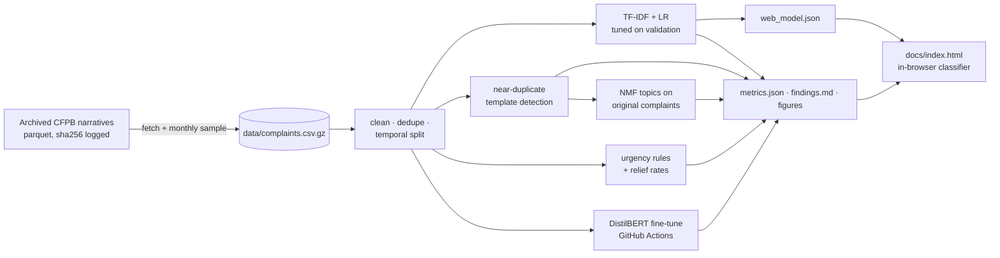

# Consumer Complaint Intelligence


**Live dashboard: [madhubuddaraju.github.io/consumer-complaints-nlp](https://madhubuddaraju.github.io/consumer-complaints-nlp/)**
(paste a complaint and watch the model route it, in your browser)

An NLP system over **53,276 real consumer complaints** filed with the U.S. Consumer Financial Protection Bureau
(CFPB). It answers the questions a complaints team at a bank or regulator actually has:

1. **Routing**: which product is this complaint about, and how sure are we? (text classification)
2. **Form letters**: how many complaints are copies of a template, and where? (near-duplicate detection)
3. **Emerging issues**: what are people complaining about more this quarter? (topic modeling + growth z-scores)
4. **Triage**: which complaints describe urgent harm, and do they get help? (auditable rules + outcome analysis)

## Results

| | |
|---|---|
| Word-for-word duplicate narratives | **25%** (18,278 of 72,387), removed before modeling |
| Near-copies of a form letter among the rest | **37%**, and **49%** in credit reporting |
| Routing, TF-IDF + logistic regression | macro-F1 **0.649**, accuracy **0.819** on the latest 3 months |
| Routing, fine-tuned DistilBERT (CPU budget, 11k examples) | macro-F1 **0.605**, accuracy **0.748**: the simpler model won |
| Auto-routable at ≥90% confidence | **42%** of complaints, **93%** accurate |
| Fastest-growing issue | hard / unauthorized credit inquiries (**z = +3.3**) |
| Complaints describing urgent harm | **24%**; "losing my home" complaints got relief only **24%** of the time vs 38% for others |

Full write-up with charts: **[reports/findings.md](reports/findings.md)** (regenerated by the pipeline).

| Template letters | Per-class F1 |
|---|---|
|  |  |
| **Emerging themes** | **Urgent harms and relief** |
|  |  |

## Design decisions

**Temporal split, not random.** Models train on 2022-05 to 2023-11, are tuned on the next 2 months and tested on
2024-02 to 2024-04. Complaint language drifts (new companies, new scams, new regulations), so a random split
overstates how a model will do next quarter.

**De-duplicate before you split.** A quarter of narratives were exact copies. Left in, the same letter lands in
train and test and the model is graded on text it memorised. Exact copies are removed by a normalised text
fingerprint; near-copies are detected with word-trigram TF-IDF cosine similarity (≥ 0.6) computed in sparse
blocks so 50k × 50k comparisons fit in a few hundred MB.

**Topics on original complaints only.** Fit on everything, NMF spends half its topics on form-letter boilerplate.
Topics are fit on non-templated complaints, then each theme's share over the last 3 months is compared with the
9 months before as a z-score.

**A baseline you can ship, then a transformer.** The TF-IDF + logistic regression model is exported to JSON
(3.9 MB) and re-implemented in 40 lines of JavaScript, so the dashboard classifies text with no server. A parity
test runs the JS in Node and checks it matches scikit-learn's probabilities to 1e-3. DistilBERT is fine-tuned
on the same split in a GitHub Actions job (CPU) to measure what a transformer adds. On this budget (a quarter of
the training data, 2 epochs, 192-token inputs while 39% of narratives are longer) it scored 0.044 macro-F1
*below* the tuned baseline. Product and company names are strong keyword signals, so the cheaper model is the
one to ship here; more data, longer inputs and a GPU are the obvious next experiment.

**Rules where they need to be auditable.** Urgency is flagged with a regular-expression lexicon (foreclosure,
identity theft, frozen funds, repossession, severe hardship) plus CFPB's Servicemember and Older American tags.
Every flag can be traced to the phrase that triggered it, which matters more than recall for triage.

**Scrubbing artifacts normalised.** The CFPB redacts personal data as `XX/XX/XXXX` and `{$...}`; these are mapped
to placeholder tokens so the model doesn't learn redaction patterns.

## Architecture



## Quick start

```bash
git clone https://github.com/madhubuddaraju/consumer-complaints-nlp.git
cd consumer-complaints-nlp
python -m venv .venv && source .venv/bin/activate
make install
make all            # analyse -> report -> dashboard -> tests (a few minutes)
open docs/index.html
```

The sampled data (`data/complaints.csv.gz`, 20 MB) is committed, so no download is needed. To rebuild it from
the source parquet run `make data` (or the **Fetch CFPB data** workflow). To fine-tune DistilBERT run
`python scripts/train_transformer.py` or the **Fine-tune DistilBERT** workflow.

## Project structure

```
src/complaints/
  config.py        paths, seed, split sizes, product consolidation map
  clean.py         text normalisation, fingerprint dedupe, partial-month handling, temporal split
  classify.py      TF-IDF + logistic regression, tuning, evaluation, top terms
  templates.py     sparse block near-duplicate detection, law-citation analysis
  topics.py        NMF themes, monthly shares, emerging-theme z-scores
  urgency.py       harm lexicon and flags
  web_model.py     export of the fitted model for the browser
  run.py           pipeline -> reports/metrics.json
  report.py        figures + reports/findings.md
  web.py           static dashboard
dashboard/         HTML template and the JavaScript classifier
scripts/           data fetch and transformer fine-tuning
tests/             cleaning, rules, classifier and JS/Python parity tests on a real-data fixture
```

## Data

[CFPB Consumer Complaint Database](https://www.consumerfinance.gov/data-research/consumer-complaints/), public
domain. Narratives are published only with the consumer's consent and are scrubbed of personal information.
**In August 2026 the CFPB stopped publishing narratives**, so the official export no longer contains the text.
This project uses an archived copy of the database taken while they were public
([sovai/cfpb_complaints](https://huggingface.co/datasets/sovai/cfpb_complaints)), restricted to May 2022 to April
2024 and sampled at 3,000 complaints per month. The source checksum and counts are in
[`data/complaints_meta.json`](data/complaints_meta.json).

## Limitations

- Company counts reflect the sample, not the full database. A complaint is an allegation, not a finding.
- "Relief" is the company's own reported closing status.
- The urgency lexicon favours precision; it will miss harms described in unusual words.
- Products with few complaints (student loans, personal loans) have noisy per-class scores.

## License

MIT for the code. CFPB data is public domain.
