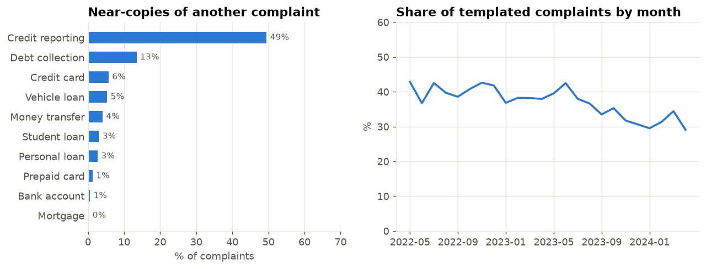
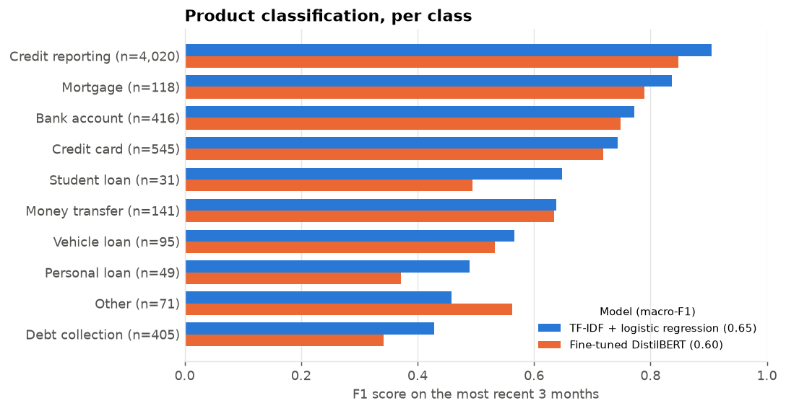
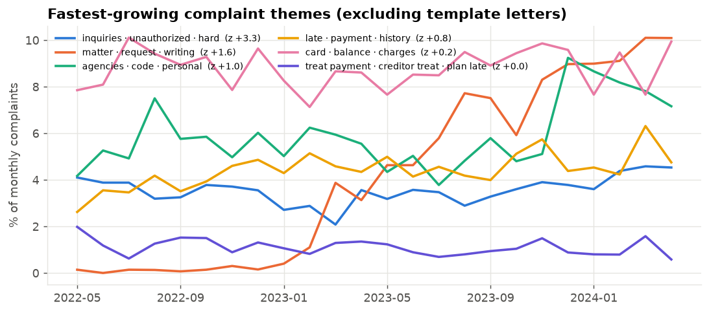
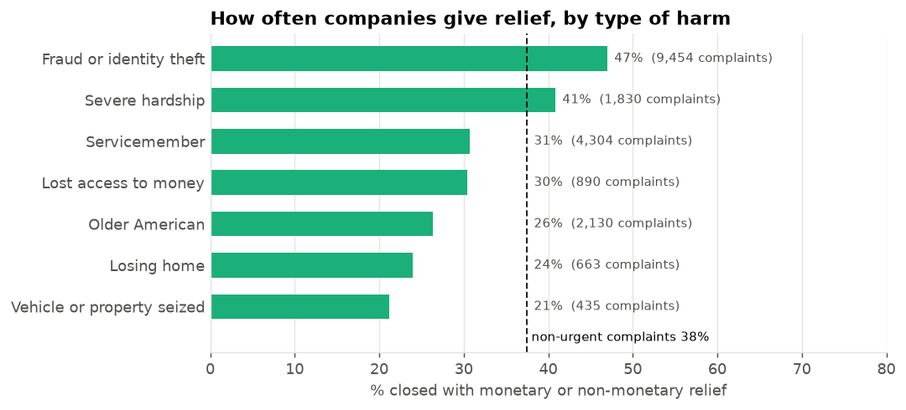

# Findings

_Generated by `python -m complaints.report` from 53,276 unique CFPB complaint narratives
(2022-05 to 2024-04)._

## 1. A quarter of narratives are exact copies, and over a third of the rest are near-copies
- **18,278 of 72,387 sampled narratives (25%) were word-for-word
  duplicates** and were removed before modeling.
- Of the remaining complaints, **37% are near-copies** of another complaint (word-trigram cosine similarity
  ≥ 0.6), rising to **49% for credit reporting**. They read like
  form letters: 61% cite consumer-protection law (FCRA sections, U.S.C. citations) versus
  24% of original complaints.
- The templated share fell from 43% to 29% over the period.
- Why it matters: duplicates inflate complaint counts against specific companies, and if they are split
  between train and test they inflate model accuracy.

## 2. Text alone identifies the product for most complaints
| Model | Macro-F1 | Accuracy |
|---|---|---|
| Always predict the most common product | 0.081 | 0.682 |
| TF-IDF + logistic regression | 0.649 | 0.819 |
| Fine-tuned DistilBERT (11,380 training examples, 2 epochs) | 0.605 | 0.748 |

- Tested on the **most recent 3 months** (2024-02 to 2024-04), trained on earlier
  months only. This temporal split mirrors deployment and is harsher than a random split.
- When the baseline is at least 90% confident (42% of complaints) it is right **93%** of
  the time. That is enough to auto-route those complaints and send the rest to a person.
- Weakest classes: Debt collection (F1 0.43) and Other (F1 0.46).
  The biggest single confusion is **Credit reporting predicted as Debt collection** (253 of 4020 test complaints): a
  collection account usually shows up on a credit report, so both labels describe the same story.
- The tuned TF-IDF model **beat the fine-tuned transformer by 0.044 macro-F1**. DistilBERT was trained on a CPU budget: 11,380 examples (about a quarter of the training set), 2 epochs, texts cut at 192 tokens, 136 minutes. Product names, company names and words like "escrow" or "repossessed" are strong keyword signals, which a linear model on the full data captures cheaply. The baseline is also the one that ships: it runs in the browser from a 4 MB file.

## 3. Emerging themes
Topic modeling (NMF on TF-IDF of non-templated complaints) found 16 themes. The fastest-growing over
the last 3 months, compared with the 9 months before:
- **inquiries · unauthorized · hard**: 4.5% of complaints, 1.29x its baseline (z = +3.3)
- **matter · request · writing**: 9.8% of complaints, 1.41x its baseline (z = +1.6)
- **agencies · code · personal**: 7.7% of complaints, 1.35x its baseline (z = +1.0)

## 4. Urgent harms and how companies respond
- **24% of complaints describe a serious harm** (losing a home, fraud or identity theft, frozen
  funds, repossession, severe hardship), flagged with an auditable phrase list.
- Fraud and identity theft is the largest group (9,454 complaints, 18%).
- Complaints about **losing a home got relief only 24% of the time**, versus 38%
  for non-urgent complaints.

## Data note
In August 2026 the CFPB stopped publishing consumer narratives, so the official export no longer has the text
column. This project uses an archived copy of the database taken while narratives were public (window
2022-05-01 to 2024-05-01), sampled at 3,000 complaints a month.
